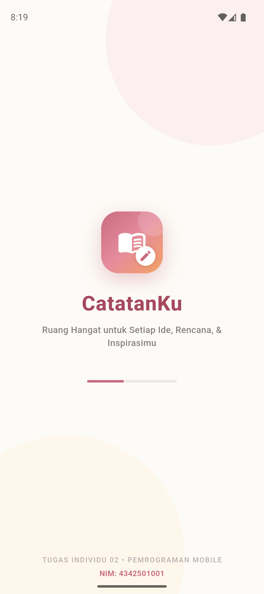
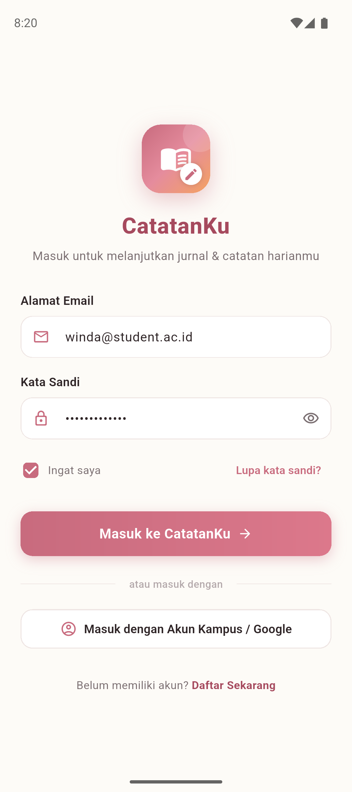
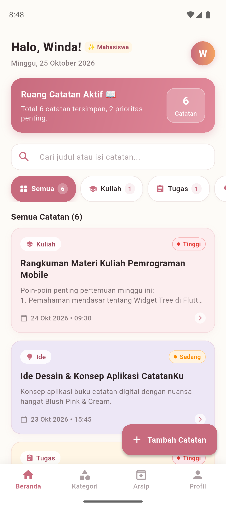
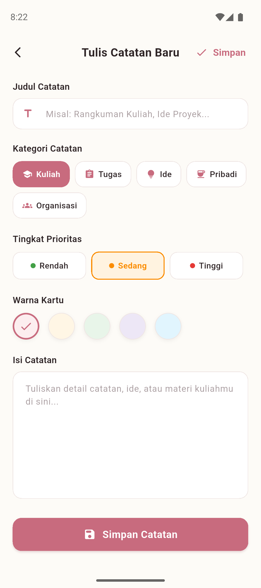
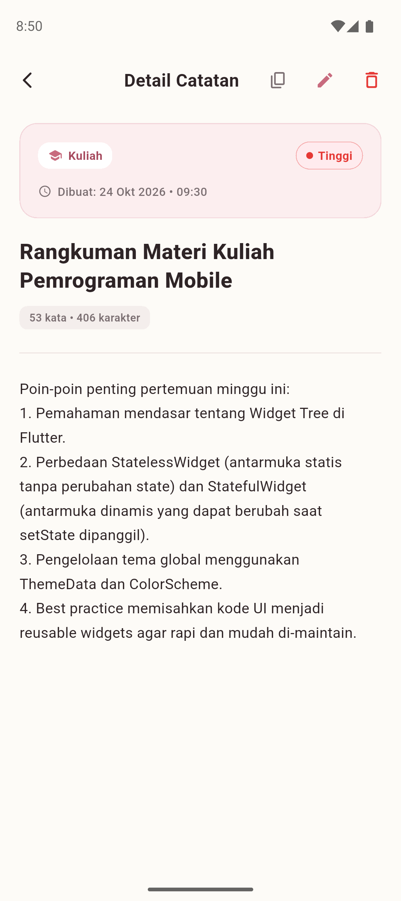
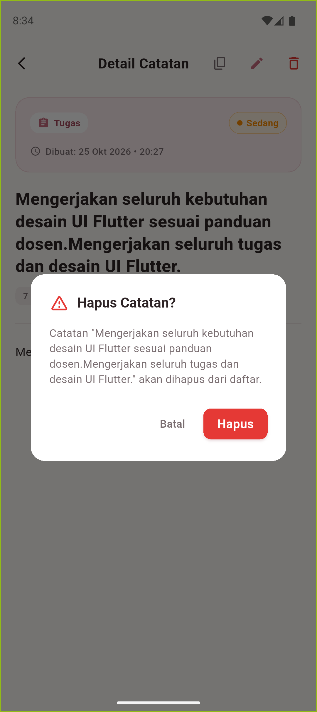
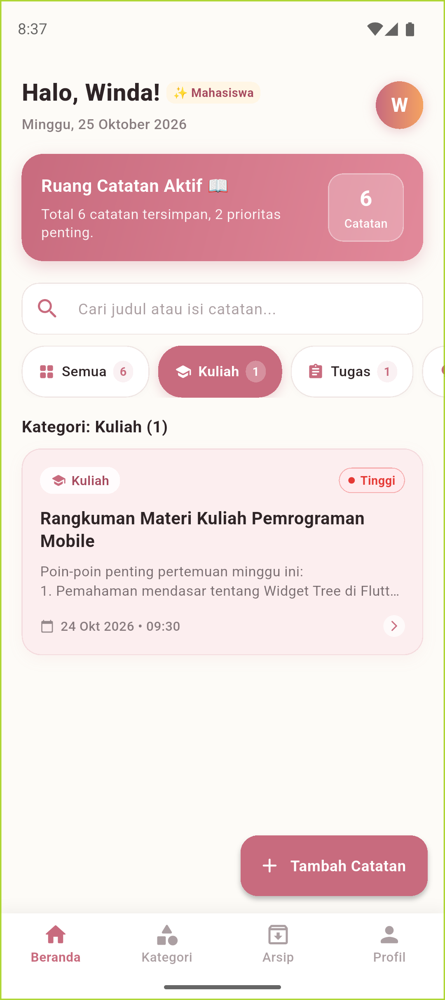
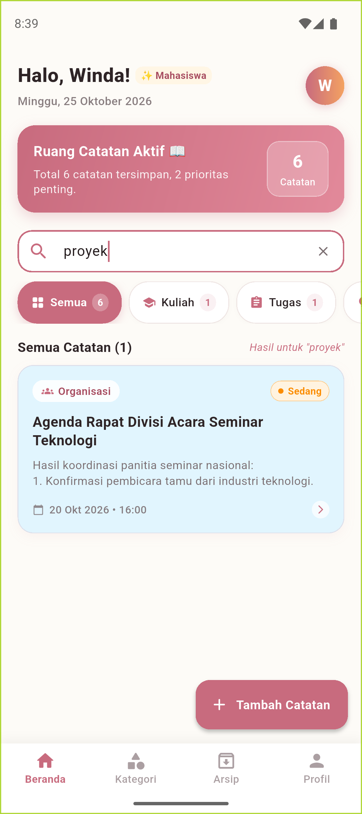
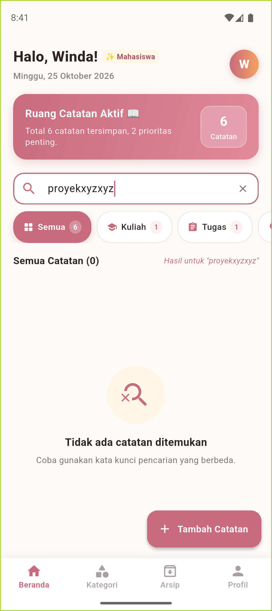

# CatatanKu 📖✨

**Aplikasi Catatan Harian Digital Mahasiswa (Frontend UI - Flutter)**
_Tugas Individu 02 - Uji Pemahaman Fase 2: Perancangan (Design) UI_

---

## 📌 Identitas Mahasiswa & Proyek

- **Nama Mahasiswa :** Winda
- **NIM :** 4342501001
- **Nama Proyek :** `catatanku_4342501001`
- **Mata Kuliah :** Pemrograman Perangkat Bergerak (Mobile Programming)
- **Platform Target :** Flutter & Dart (Android Pixel 9 API 35)

---

## 🎨 Konsep Desain & Identitas Visual

Aplikasi **CatatanKu** dirancang secara orisinal dengan filosofi **"Warm Aesthetic Journal"**. Menggunakan palet warna **Blush Pink & Warm Cream** yang memberikan suasana tenang, rapi, dan menyejukkan mata bagi mahasiswa saat mencatat materi kuliah, jadwal tugas, maupun ide pribadi.

### Palet Warna Utama

| Elemen             | Kode HEX                          | Peran & Alasan Pemilihan                                                                                            |
| ------------------ | --------------------------------- | ------------------------------------------------------------------------------------------------------------------- |
| **Primary Blush**  | `#C86B7E` & `#D97D8F`             | Warna utama untuk tombol aksi (_FAB_, tombol masuk, tombol simpan) dan aksen aktif. Memberi kesan ramah dan hangat. |
| **Warm Cream**     | `#FDFBF7`                         | Latar belakang layar (_Scaffold Canvas_). Bebas silau (_eye-comfort_) dibanding putih pekat standar.                |
| **Warm Surface**   | `#FFFFFF` & `#FFF9F5`             | Permukaan kartu catatan dan input form dengan bayangan lembut (_soft warm elevation_).                              |
| **Warm Charcoal**  | `#2E2426`                         | Warna tipografi utama berkontras tinggi (memenuhi standar WCAG AAA) tanpa ketajaman warna hitam pekat.              |
| **Muted Slate**    | `#7A6E71`                         | Warna teks sekunder untuk tanggal, cuplikan isi catatan, dan petunjuk form (_hint_).                                |
| **Pastel Accents** | Blush, Cream, Mint, Lavender, Sky | Warna pembeda kartu catatan berdasarkan pilihan pengguna.                                                           |

---

## 📱 Lima Halaman Utama (Sesuai Kebutuhan Tugas)

Aplikasi CatatanKu mengimplementasikan 5 halaman lengkap dengan alur navigasi dan interaksi _stateful_:

```
[1. Splash Screen] ➔ [2. Login Statis] ➔ [3. Beranda] ⇄ [4. Tambah/Edit Catatan]
                                              ⇅
                                     [5. Detail Catatan]
```

### 1. Splash Screen (`lib/screens/splash_screen.dart`)

- **Tampilan:** Logo orisinal berupa buku catatan terbuka dengan aksen pena berkilau, judul aplikasi "CatatanKu", slogan _"Ruang Hangat untuk Setiap Ide, Rencana, & Inspirasimu"_, dan animasi _linear progress indicator_.
- **Fitur:** Transisi otomatis halus (_FadeTransition_) menuju halaman Login setelah 4 detik, atau dapat langsung diketuk (_tap-to-skip_).

### 2. Login Statis (`lib/screens/login_screen.dart`)

- **Tampilan:** Form masuk modern dengan input Email (_with icon_), Password (_with obscure/eye toggle_), _checkbox_ "Ingat Saya", tombol "Masuk ke CatatanKu" bergradasi Blush Pink, dan opsi masuk via Akun Kampus / Google.
- **Interaksi:** Validasi form (memastikan email dan kata sandi terisi dengan benar). Menampilkan _feedback SnackBar_ dan navigasi mulus ke Beranda.

### 3. Beranda / Home (`lib/screens/home_screen.dart`)

- **Tampilan:**
  - Sapaan ramah: _"Halo, Winda! 👋 ✨ Mahasiswa"_ dengan tanggal terkini dan inisial avatar profil.
  - Kartu Ringkasan Aktivitas (_Activity Banner_): Total catatan tersimpan dan jumlah catatan prioritas tinggi.
  - Kolom Pencarian Cepat (_Real-time Search Bar_) dengan tombol hapus (_clear icon_).
  - Filter Kategori (_Horizontal Scrollable Chips_): Semua, Kuliah, Tugas, Ide, Pribadi, dan Organisasi disertai jumlah _counter_.
  - Daftar Kartu Catatan (_NoteCard_): Menampilkan label kategori berikon, badge prioritas, judul, cuplikan 2 baris, dan tanggal.
  - _Empty State_: Tampilan ramah bila pencarian atau kategori tidak menemukan catatan.
  - _Floating Action Button (FAB)_: Tombol "+ Tambah Catatan".
  - _Bottom Navigation Bar_: Menu Beranda, Kategori, Arsip, dan Profil.

### 4. Tambah & Edit Catatan (`lib/screens/note_form_screen.dart`)

- **Tampilan & Form:**
  - Input Judul Catatan.
  - Pilihan Kategori berbentuk pill berikon (_Kuliah, Tugas, Ide, Pribadi, Organisasi_).
  - Pilihan Prioritas interaktif (_Rendah 🟢, Sedang 🟡, Tinggi 🔴_).
  - Pilihan Palet Warna Kartu (5 pilihan warna pastel dengan indikator _checkmark_ aktif).
  - Input Isi Catatan (_multi-line_ hingga 15 baris).
- **Interaksi:** Validasi kelengkapan form, tombol Simpan di AppBar maupun tombol besar di bawah. Dapat digunakan untuk membuat catatan baru maupun mengedit catatan yang sudah ada.

### 5. Detail Catatan (`lib/screens/note_detail_screen.dart`)

- **Tampilan:**
  - Header banner bernuansa warna kartu pilihan, memuat kategori, badge prioritas, dan stempel waktu pembuatan.
  - Judul catatan lengkap dan indikator jumlah kata serta karakter.
  - Isi catatan lengkap dengan tipografi yang nyaman dibaca (_relaxed line height_).
- **Aksi:**
  - Tombol **Salin Teks** (_Copy to Clipboard_) dengan konfirmasi _SnackBar_.
  - Tombol **Edit Catatan**: Membuka form edit dan memperbarui data secara langsung.
  - Tombol **Hapus Catatan**: Menampilkan dialog peringatan konfirmasi (_AlertDialog_) sebelum menghapus catatan dari daftar.

---

## 🖼️ Tangkapan Layar Aplikasi (Screenshots)

Berikut tangkapan layar asli aplikasi **CatatanKu** yang dijalankan pada emulator **Android Pixel 9 (API 35)**:

|                  1. Splash Screen                  |                 2. Login Statis                  |             3. Beranda (Home)              |
| :------------------------------------------------: | :----------------------------------------------: | :----------------------------------------: |
|  |  |  |

|                  4. Tambah Catatan                   |                  5. Detail Catatan                   |              6. Dialog Hapus Catatan              |
| :--------------------------------------------------: | :--------------------------------------------------: | :-----------------------------------------------: |
|  |  |  |

|                  7. Filter Kategori (Kuliah)                  |                  8. Pencarian Real-Time                   |       9. Empty State (Pencarian Kosong)        |
| :-----------------------------------------------------------: | :-------------------------------------------------------: | :--------------------------------------------: |
|  |  |  |

---

## 📂 Struktur Folder & Arsitektur Kode

Kode program disusun secara modular berdasarkan pemisahan tanggung jawab (_Separation of Concerns_), sehingga rapi, tidak menumpuk dalam `main.dart`, dan mudah dipelajari oleh pemula:

```
catatanku_4342501001/
├── lib/
│   ├── main.dart                      # Titik masuk utama aplikasi, orientasi UI sistem, dan konfigurasi tema
│   │
│   ├── models/                        # [Data Layer] Model data & enumerasi
│   │   └── note_model.dart            # Model Note, NoteCategory, dan NotePriority
│   │
│   ├── theme/                         # [Styling Layer] Sentralisasi warna, font, dan ThemeData
│   │   └── app_theme.dart             # Palet warna Blush Pink & Cream, gaya Card, Button, dan Input
│   │
│   ├── data/                          # [Mock Data Layer] Data awal yang realistis untuk mahasiswa
│   │   └── dummy_data.dart            # 6 contoh catatan relevan kehidupan perkuliahan
│   │
│   ├── widgets/                       # [Reusable Widgets] Komponen antarmuka yang dapat digunakan berulang
│   │   ├── app_logo.dart              # Logo orisinal vector CatatanKu
│   │   ├── priority_badge.dart        # Pill indikator prioritas (Rendah/Sedang/Tinggi)
│   │   ├── category_chip.dart         # Pill filter kategori berikon
│   │   ├── note_card.dart             # Kartu ringkasan catatan pada daftar beranda
│   │   └── custom_text_field.dart     # Input form seragam dengan border melengkung halus
│   │
│   └── screens/                       # [Presentation Layer] 5 Halaman Wajib Tugas
│       ├── splash_screen.dart         # Halaman 1: Pembuka aplikasi & animasi identitas
│       ├── login_screen.dart          # Halaman 2: Formulir login statis & validasi
│       ├── home_screen.dart           # Halaman 3: Beranda (Search, Filter, List, Activity Summary)
│       ├── note_form_screen.dart      # Halaman 4: Tambah dan Edit Catatan
│       └── note_detail_screen.dart    # Halaman 5: Tampilan lengkap catatan & aksi edit/hapus
│
├── screenshots/                       # Dokumentasi tangkapan layar output pengujian pada Pixel 9
├── test/
│   └── widget_test.dart               # Unit/Widget test untuk memverifikasi inisialisasi aplikasi
├── pubspec.yaml                       # Konfigurasi proyek Flutter
└── README.md                          # Dokumentasi resmi proyek
```

---

## 🛠️ Teknologi & Lingkungan Pengembangan

- **Framework :** Flutter (Channel Stable 3.47.2)
- **Language :** Dart (SDK 3.13.2)
- **Design :** Material 3 (Material Design System)
- **Device :** Android Emulator Pixel 9 (API 35, Android 15)
- **Linter :** `flutter_lints` (Hasil analisis: _0 warnings, 0 errors_)

---

## 🚀 Cara Menjalankan Aplikasi di Komputer Lokal

### 1. Prasyarat

Pastikan Flutter SDK sudah terpasang dan emulator Android sudah aktif. Periksa dengan perintah:

```bash
flutter doctor
```

### 2. Kloning Repository

```bash
git clone https://github.com/[username-kamu]/catatanku_4342501001.git
cd catatanku_4342501001
```

### 3. Unduh Paket Dependensi

```bash
flutter pub get
```

### 4. Periksa Analisis Kode

```bash
flutter analyze
```

### 5. Jalankan Aplikasi

Jalankan pada emulator Android Pixel 9 atau perangkat aktif lainnya:

```bash
flutter run
```

---

## 📝 Catatan Pengelolaan State Frontend

Aplikasi ini berfokus pada **Frontend UI**. Seluruh data catatan dikelola di dalam memori aplikasi (_In-Memory State_ menggunakan `StatefulWidget` bawaan Flutter). Data penambahan, perubahan, dan penghapusan catatan akan aktif selama sesi aplikasi berjalan, dan akan kembali ke data awal jika aplikasi dimulai ulang (_restart_).
